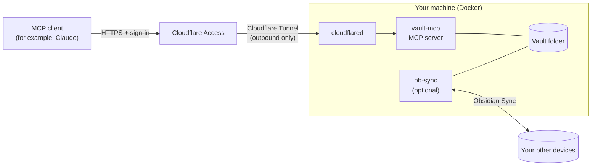

# obsidian-remote-mcp

Use your Obsidian vault from Claude and other AI apps, from anywhere. obsidian-remote-mcp runs your vault as a remote MCP server behind Cloudflare. You don't need to open ports on your network, install an Obsidian plugin, or write any sign-in code.

> [!NOTE]
> MCP (Model Context Protocol) is an open standard that lets AI apps use tools. Here, the tools search, read, and edit the notes in your vault.

## What you get

- **Access from anywhere.** Claude on the web, on your desktop, and on your phone can search, read, and write your notes.
- **No open ports.** The server connects out to Cloudflare. Nothing on your network accepts incoming connections.
- **Only you can sign in.** Cloudflare Access checks who you are before any request reaches your vault. The free Cloudflare plan covers this.
- **Your choice of where the vault comes from.** Serve a vault folder that's already on the machine, or keep a copy in step with Obsidian Sync.
- **Optional safety modes.** Limit clients to read-only access, or let them write to one folder only.

## How it works

The project is a Docker Compose file that connects existing open-source tools:

| Part | What it does |
|---|---|
| [MCPVault](https://github.com/bitbonsai/mcpvault) | The MCP server. Reads and writes the Markdown files in your vault folder. |
| [supergateway](https://github.com/supercorp-ai/supergateway) | Makes MCPVault reachable over the web (Streamable HTTP at `/mcp`). |
| [cloudflared](https://github.com/cloudflare/cloudflared) | Opens a secure, outbound-only tunnel to Cloudflare. |
| [Cloudflare Access](https://developers.cloudflare.com/cloudflare-one/access-controls/applications/http-apps/managed-oauth/) | Signs you in with OAuth and blocks everyone else. |
| [obsidian-headless](https://www.npmjs.com/package/obsidian-headless) | Optional. The official Obsidian Sync command-line client. |

## Choose a setup

| | Local folder | Obsidian Sync |
|---|---|---|
| **Use it when** | Docker runs on the computer that already has your vault, or another tool (such as Syncthing, Git, or Dropbox) copies your vault to the server. | The server is somewhere else, such as a cloud server, a NAS, or a Raspberry Pi, and you use Obsidian Sync. |
| **Needs Obsidian Sync** | No | Yes |
| **Works while your main computer is off** | No, unless the server is a different machine | Yes, if the server stays on |

Both setups use the same Cloudflare steps and the same MCP server.

## Requirements

- A computer or server that runs Docker with Docker Compose. Linux, macOS, Windows, cloud servers, and some NAS devices work. See [Where it runs](docs/platforms.md).
- A domain name that uses Cloudflare DNS.
- A free [Cloudflare Zero Trust](https://www.cloudflare.com/zero-trust/products/access/) account.
- An MCP client that can connect to a remote server and sign in with OAuth, such as Claude. See [Compatible MCP clients](docs/clients.md).
- For the Obsidian Sync setup only: an [Obsidian Sync](https://obsidian.md/sync) subscription.

## Get started

1. [Set up the server](docs/setup.md).
2. [Set up Cloudflare](docs/cloudflare.md).
3. [Connect your MCP client](docs/clients.md).
4. [Make it start automatically](docs/operations.md#start-automatically).

## Documentation

| Page | Covers |
|---|---|
| [Set up the server](docs/setup.md) | Install and configure, for both setups |
| [Set up Cloudflare](docs/cloudflare.md) | Tunnel, Access, and sign-in |
| [Compatible MCP clients](docs/clients.md) | Which apps work and how to connect them |
| [Where it runs](docs/platforms.md) | Linux, macOS, Windows, cloud servers, Synology, Raspberry Pi |
| [Security and safety modes](docs/security.md) | What's protected, read-only mode, Inbox-only mode |
| [Run and maintain](docs/operations.md) | Start at boot, emergency stop, updates, uninstall |
| [Troubleshooting](docs/troubleshooting.md) | Known problems and fixes |

## License

The files in this repository use the [MIT License](LICENSE).

The setup downloads and builds other software on your machine. Each keeps its own license:

| Software | License |
|---|---|
| MCPVault | MIT |
| supergateway | MIT |
| cloudflared | Apache 2.0 |
| obsidian-headless | Proprietary (published by Obsidian as `UNLICENSED`) |

> [!IMPORTANT]
> This repository doesn't include obsidian-headless, and the project doesn't publish prebuilt images. Docker downloads obsidian-headless from npm when you build the images on your machine. Don't push your built `ob-sync` image to a public registry. Your use of Obsidian Sync is subject to Obsidian's terms.

This project isn't affiliated with or endorsed by Obsidian, Cloudflare, or Anthropic.
