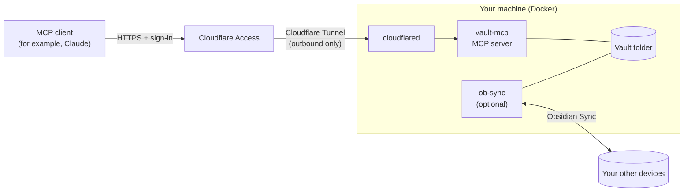

# obsidian-remote-mcp

Use your Obsidian vault from Claude and other AI apps, from anywhere. obsidian-remote-mcp runs your vault as a remote MCP server behind Cloudflare. You don't need to open ports on your network, install an Obsidian plugin, or write any sign-in code.

> [!NOTE]
> MCP (Model Context Protocol) is an open standard that lets AI apps use tools. Here, the tools search, read, and edit the notes in your vault.

## What you get

- **Access from anywhere.** Claude on the web, on your desktop, and on your phone can search, read, and write your notes.
- **No open ports.** The server connects out to Cloudflare. Nothing on your network accepts incoming connections.
- **Only you can sign in.** Cloudflare Access checks who you are before any request reaches your vault. The free Cloudflare plan covers this.
- **Your choice of where the vault comes from.** Serve a vault folder that's already on the machine, or keep a copy in step with Obsidian Sync.
- **Optional safety modes.** Limit clients to read-only access, or let them write to one folder only.

## Requirements

- A computer or server that runs Docker with Docker Compose. Linux, macOS, Windows, cloud servers, and some NAS devices work. See [Where it runs](docs/platforms.md).
- A domain name that uses Cloudflare DNS.
- A free [Cloudflare Zero Trust](https://www.cloudflare.com/zero-trust/products/access/) account.
- An MCP client that can connect to a remote server and sign in with OAuth, such as Claude. See [Compatible MCP clients](docs/clients.md).
- For the Obsidian Sync setup only: an [Obsidian Sync](https://obsidian.md/sync) subscription.

## How it works



The project is a Docker Compose file that connects existing open-source tools:

| Part | What it does |
|---|---|
| [MCPVault](https://github.com/bitbonsai/mcpvault) | The MCP server. Reads and writes the Markdown files in your vault folder. |
| [supergateway](https://github.com/supercorp-ai/supergateway) | Makes MCPVault reachable over the web (Streamable HTTP at `/mcp`). |
| [cloudflared](https://github.com/cloudflare/cloudflared) | Opens a secure, outbound-only tunnel to Cloudflare. |
| [Cloudflare Access](https://developers.cloudflare.com/cloudflare-one/access-controls/applications/http-apps/managed-oauth/) | Signs you in with OAuth and blocks everyone else. |
| [obsidian-headless](https://www.npmjs.com/package/obsidian-headless) | Optional. The official Obsidian Sync command-line client. |

## Choose a setup

obsidian-remote-mcp works with any Obsidian vault: a standalone vault that's just a folder of files, or a vault that uses Obsidian Sync. You pick one of two setups, based on where your vault lives and where the server runs. You make the choice once, in your `.env` file, and you can change it later.

### Local folder setup: a standalone vault

The server reads and writes a vault folder that's already on the machine. Obsidian doesn't need to know about the server, and you don't need an Obsidian Sync subscription.

Choose this setup in these cases:

- **Docker runs on the computer that has your vault.** The server and the Obsidian app work on the same files. If that vault also uses Obsidian Sync, the Obsidian app syncs the server's changes to your other devices, as long as Obsidian is open.
- **Your vault isn't synced, or another tool syncs it.** For example, iCloud Drive, Dropbox, Syncthing, or Git keeps a copy of the vault on the server. Point the server at that copy.

The server is reachable only while that machine is on and awake.

### Obsidian Sync setup: a vault that uses Obsidian Sync

The server keeps its own copy of your vault with the official Obsidian Sync client, and shows up as one more device in Obsidian Sync. Changes that an AI app makes reach your phone and computers through Obsidian Sync, and your own edits reach the server the same way.

Choose this setup when the server runs somewhere other than your main computer, such as a cloud server, a NAS, or a Raspberry Pi. Your vault stays reachable even when your computers are off.

This setup needs an Obsidian Sync subscription.

### Compare the setups

| | Local folder | Obsidian Sync |
|---|---|---|
| **Vault** | A folder already on the machine | A copy that Obsidian Sync keeps up to date |
| **Needs Obsidian Sync** | No | Yes |
| **Works while your main computer is off** | Only if the server is a different, always-on machine | Yes, if the server stays on |
| **Turn it on** | Leave `COMPOSE_PROFILES` empty in `.env` (the default) | Set `COMPOSE_PROFILES=obsidian-sync` in `.env` |

Both setups use the same Cloudflare steps, the same MCP server, and the same safety modes.

## Quick start

These commands set up the server on Linux or macOS. For Windows, or for an explanation of each step, follow the [step-by-step guides](#step-by-step-guides) instead.

Before you begin:

- Install Docker with Docker Compose.
- Do the dashboard steps in [Set up Cloudflare](docs/cloudflare.md). They happen in a web browser, so they can't be pasted here. When you finish, you have a tunnel token and a hostname, such as `vault-mcp.example.com`.

1. Set your values. Replace the vault path and the hostname. The `read` command asks for your tunnel token, so that the token isn't saved in your shell history.

   ```bash
   VAULT_DIR="$HOME/Documents/MyVault"
   MCP_HOST="vault-mcp.example.com"
   read -rsp 'Tunnel token: ' TUNNEL_TOKEN; echo
   ```

   For the Obsidian Sync setup, use `VAULT_DIR="./data/vault"` instead.

1. Download the project and write your settings:

   ```bash
   git clone https://github.com/HGWingless/obsidian-remote-mcp.git
   cd obsidian-remote-mcp
   cp .env.example .env && chmod 600 .env
   sed -i.bak \
     -e "s|^VAULT_DIR=.*|VAULT_DIR=$VAULT_DIR|" \
     -e "s|^TUNNEL_TOKEN=.*|TUNNEL_TOKEN=$TUNNEL_TOKEN|" \
     .env && rm .env.bak
   mkdir -p "$VAULT_DIR" data/ob-home
   ```

1. On Linux only, run the containers as the owner of your vault folder. Skip this step on macOS.

   ```bash
   sed -i.bak \
     -e "s|^PUID=.*|PUID=$(stat -c %u "$VAULT_DIR")|" \
     -e "s|^PGID=.*|PGID=$(stat -c %g "$VAULT_DIR")|" \
     .env && rm .env.bak
   ```

1. For the Obsidian Sync setup only, connect to Obsidian Sync. Replace `VAULT_NAME` with the name of your vault, as the list command shows it. `ob login` asks for your Obsidian email, password, and two-factor code. `ob sync-setup` asks for your encryption password if your vault uses end-to-end encryption.

   ```bash
   sed -i.bak "s|^COMPOSE_PROFILES=.*|COMPOSE_PROFILES=obsidian-sync|" .env && rm .env.bak
   docker compose build
   docker compose run --rm ob-sync ob login
   docker compose run --rm ob-sync ob sync-list-remote
   docker compose run --rm ob-sync ob sync-setup --vault "VAULT_NAME" --path /vault --device-name mcp-server
   docker compose run --rm ob-sync ob sync-config --path /vault --mode pull-only --conflict-strategy merge --configs ""
   docker compose run --rm ob-sync ob sync --path /vault
   docker compose run --rm ob-sync ob sync-config --path /vault --mode bidirectional
   ```

   These commands download your vault once, and then turn on two-way sync. To sync notes only, without attachments, run `scripts/notes-only.sh` before the `ob sync` command.

1. Start the server, and check it:

   ```bash
   docker compose up -d --build
   scripts/check.sh "https://$MCP_HOST"
   ```

   The check shows that the MCP server is healthy and lists 18 tools, and that your public address returns `401` until you sign in.

1. Connect your MCP client. See [Compatible MCP clients](docs/clients.md).

The server starts again on its own after a reboot, as long as Docker starts with the machine. See [Start automatically](docs/operations.md#start-automatically).

## Step-by-step guides

1. [Set up the server](docs/setup.md).
2. [Set up Cloudflare](docs/cloudflare.md).
3. [Connect your MCP client](docs/clients.md).
4. [Make it start automatically](docs/operations.md#start-automatically).

## Documentation

| Page | Covers |
|---|---|
| [Set up the server](docs/setup.md) | Install and configure, for both setups |
| [Set up Cloudflare](docs/cloudflare.md) | Tunnel, Access, and sign-in |
| [Compatible MCP clients](docs/clients.md) | Which apps work and how to connect them |
| [Where it runs](docs/platforms.md) | Linux, macOS, Windows, cloud servers, Synology, Raspberry Pi |
| [Security and safety modes](docs/security.md) | What's protected, read-only mode, Inbox-only mode |
| [Run and maintain](docs/operations.md) | Start at boot, emergency stop, updates, uninstall |
| [Troubleshooting](docs/troubleshooting.md) | Known problems and fixes |

## License

The files in this repository use the [MIT License](LICENSE).

The setup downloads and builds other software on your machine. Each keeps its own license:

| Software | License |
|---|---|
| MCPVault | MIT |
| supergateway | MIT |
| cloudflared | Apache 2.0 |
| obsidian-headless | Proprietary (published by Obsidian as `UNLICENSED`) |

> [!IMPORTANT]
> This repository doesn't include obsidian-headless, and the project doesn't publish prebuilt images. Docker downloads obsidian-headless from npm when you build the images on your machine. Don't push your built `ob-sync` image to a public registry. Your use of Obsidian Sync is subject to Obsidian's terms.

This project isn't affiliated with or endorsed by Obsidian, Cloudflare, or Anthropic.
